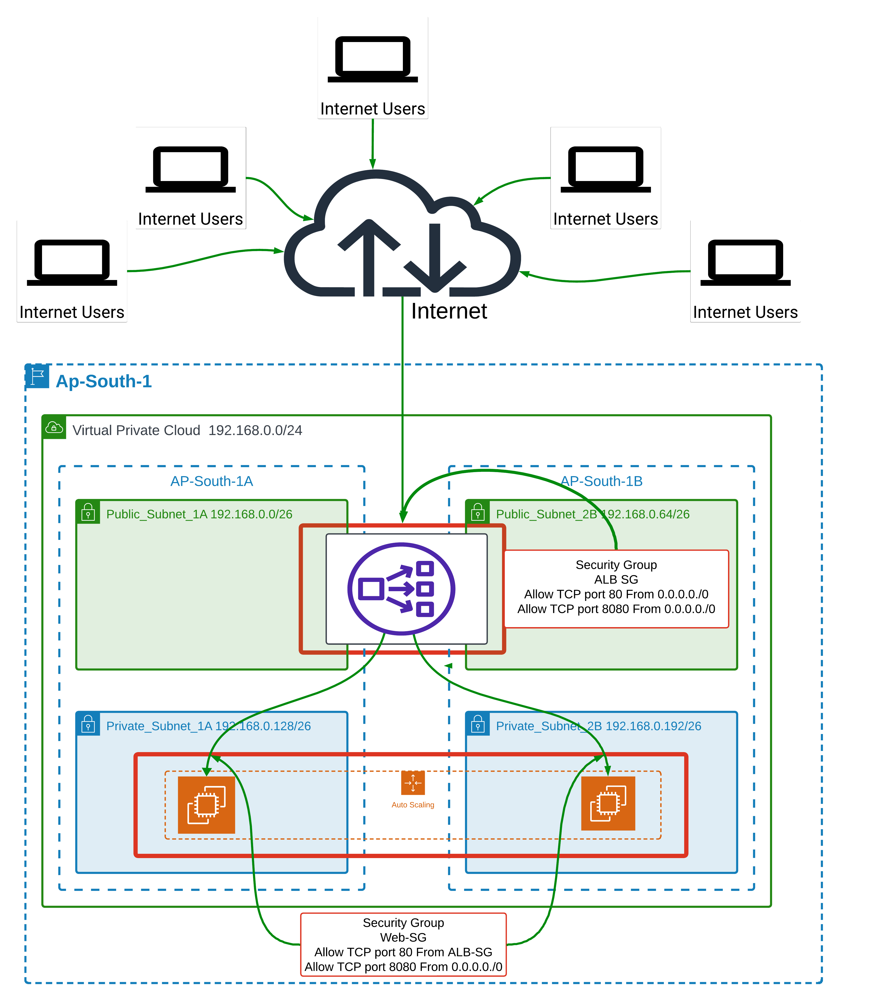
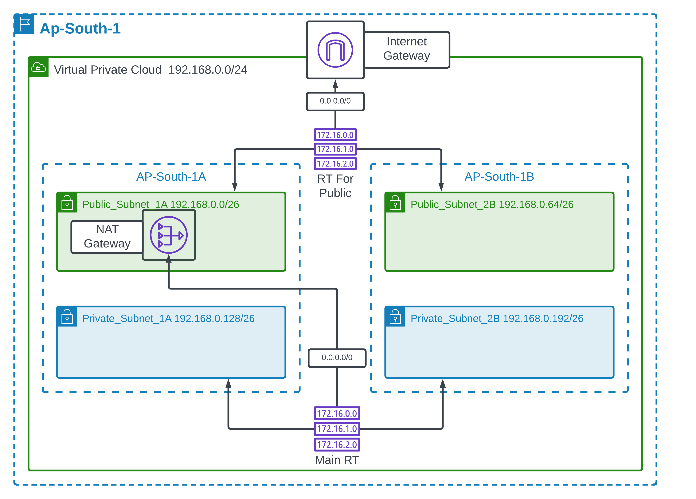

# Resilient and Scalable Web Application Deployment on AWS

## Project Overview

This project demonstrates the design and deployment of a resilient, highly available, and scalable web application infrastructure using Amazon Web Services (AWS).

The infrastructure uses an Application Load Balancer (ALB) to distribute incoming application traffic across multiple EC2 instances. Amazon EC2 Auto Scaling manages application capacity, while Amazon Elastic File System (EFS) provides shared storage across the EC2 instances.

The architecture follows important AWS cloud architecture principles, including high availability, scalability, network isolation, and security.

## Project Objectives

- Design a highly available cloud infrastructure.
- Deploy resources across multiple Availability Zones.
- Distribute application traffic using an Application Load Balancer.
- Implement automatic scaling using an EC2 Auto Scaling Group.
- Configure shared storage using Amazon EFS.
- Separate public and private network resources.
- Implement network security using Security Groups.
- Automate EC2 instance configuration using Launch Templates and User Data.
- Understand AWS infrastructure deployment and troubleshooting.

---

## AWS Architecture Overview

The infrastructure is deployed in the **Asia Pacific (Mumbai) Region (`ap-south-1`)** across two Availability Zones:

- `ap-south-1a`
- `ap-south-1b`

The project uses a custom VPC with public and private subnets distributed across both Availability Zones.

### Architecture Diagram

### VPC Network Diagram

### Network Configuration

- **VPC Name:** `my-project-vpc`
- **VPC CIDR:** `192.168.0.0/24`
- **Region:** `ap-south-1`
- **Availability Zones:** `ap-south-1a`, `ap-south-1b`

### Subnet Configuration

**Public Subnets**

- `public-subnet-1a` — `192.168.0.0/26`
- `public-subnet-2b` — `192.168.0.64/26`

**Private Subnets**

- `private-subnet-1a` — `192.168.0.128/26`
- `private-subnet-2b` — `192.168.0.192/26`

### Application Traffic Flow

1. Internet users send HTTP requests to the application.
2. Traffic enters the VPC through the Internet Gateway.
3. The Application Load Balancer receives incoming requests.
4. The ALB forwards requests to the configured Target Group.
5. The Target Group routes requests to healthy registered EC2 instances.
6. The EC2 instances are managed by an Auto Scaling Group.
7. The application instances run across multiple Availability Zones.
8. Amazon EFS provides shared storage to the EC2 instances.

---

## AWS Services Used

### Amazon VPC
Provides an isolated networking environment for the project infrastructure.

### Amazon EC2
Hosts the web application on virtual machines.

### Application Load Balancer (ALB)
Distributes incoming HTTP application traffic across registered EC2 instances.

### EC2 Auto Scaling Group
Manages the number of EC2 instances according to configured capacity settings and scaling policies.

### EC2 Launch Template
Defines the configuration used to launch application instances.

### Amazon EFS
Provides shared file storage that can be accessed by multiple EC2 instances.

### Internet Gateway
Enables communication between the VPC and the internet.

### NAT Gateway
Provides outbound internet connectivity to resources located in private subnets.

### Security Groups
Control inbound and outbound network traffic to AWS resources.

### Route Tables
Define how network traffic is routed within the VPC and to external networks.

### Amazon CloudWatch
Provides AWS resource monitoring capabilities through available metrics.

---

## Key Features

- High availability across multiple Availability Zones.
- Load balancing across EC2 instances.
- Automatic scaling of compute resources.
- Shared storage using Amazon EFS.
- Public and private subnet architecture.
- Controlled network access using Security Groups.
- Automated EC2 configuration using Launch Templates and User Data.
- Outbound internet connectivity for private resources through NAT Gateway.
- Improved network security following the principle of least privilege.

---

## Security Implementation

Security Groups are configured to restrict communication between infrastructure components.

### ALB-SG

- HTTP port `80` from anywhere.
- Custom TCP port `8080` restricted to the administrator's IP address.

### web-server-SG

- HTTP port `80` from `ALB-SG`.
- Custom TCP port `8080` from `ALB-SG`.

### EFS-SG

- NFS port `2049` from `web-server-SG`.

Unrestricted inbound rules were removed to improve network security and restrict access to trusted sources.

---

## Repository Structure

The repository is organized into the following directories:

- `README.md` — Main project overview.
- `architecture/` — Architecture diagrams and documentation.
- `infrastructure/` — AWS infrastructure component documentation.
- `deployment/` — Deployment procedures and User Data documentation.
- `security/` — Security implementation and Security Group configurations.
- `testing/` — Testing procedures and results.
- `troubleshooting/` — Challenges encountered and their solutions.
- `screenshots/` — AWS Console and application screenshots.
- `scripts/` — Deployment and configuration scripts.

---

## Project Documentation

### Architecture

- [Architecture Overview](architecture/architecture.md)

### Infrastructure

- [VPC Configuration](infrastructure/vpc.md)
- [Subnet Configuration](infrastructure/subnets.md)
- [Route Tables](infrastructure/route-tables.md)
- [Internet Gateway](infrastructure/internet-gateway.md)
- [NAT Gateway](infrastructure/nat-gateway.md)
- [Application Load Balancer](infrastructure/alb.md)
- [Target Group](infrastructure/target-group.md)
- [Launch Template](infrastructure/launch-template.md)
- [Auto Scaling Group](infrastructure/auto-scaling.md)
- [Amazon EFS](infrastructure/efs.md)
- [Monitoring](infrastructure/monitoring.md)

### Deployment

- [Deployment Guide](deployment/deployment-guide.md)
- [EC2 User Data Script](deployment/user-data-script.md)

### Security

- [Security Groups Configuration](security/security-groups.md)

### Testing

- [Testing and Results](testing/testing-results.md)

### Troubleshooting

- [Challenges and Solutions](troubleshooting/challenges-and-solutions.md)

---

## Testing and Validation

The project includes testing procedures for the following components:

- Application accessibility through the Load Balancer.
- Target Group health checks.
- EC2 instance status.
- Auto Scaling functionality.
- EFS connectivity and shared storage.
- Network connectivity and Security Group restrictions.

Screenshots and actual test results are maintained in the repository.

---

## Challenges and Troubleshooting

The implementation involved practical work with AWS networking, Security Groups, Load Balancing, EC2 deployment, Auto Scaling, and shared storage.

The troubleshooting documentation describes the challenges, their causes, and the solutions applied.

See [Challenges and Solutions](troubleshooting/challenges-and-solutions.md).

---

## Skills Demonstrated

- AWS Cloud Infrastructure
- Amazon VPC and Networking
- Public and Private Subnets
- Route Tables and Gateways
- Amazon EC2
- Application Load Balancer
- EC2 Auto Scaling
- Launch Templates
- Amazon EFS
- Security Groups
- Linux and User Data
- Cloud Architecture
- Infrastructure Troubleshooting

---

## Conclusion

This project provided practical experience in designing and deploying a scalable AWS infrastructure.

It demonstrates how networking, load balancing, Auto Scaling, shared storage, and security configurations work together to support a resilient cloud-based application.

---

**Project:** Resilient and Scalable Web Application Deployment on AWS

**Cloud Platform:** Amazon Web Services (AWS)

**Region:** Asia Pacific (Mumbai) — `ap-south-1`